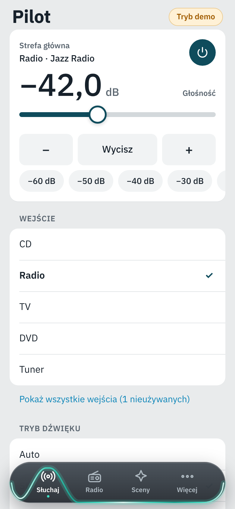
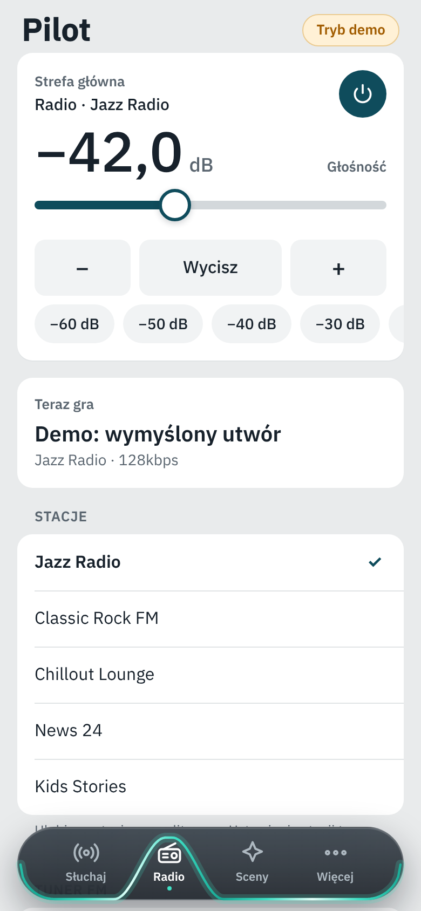
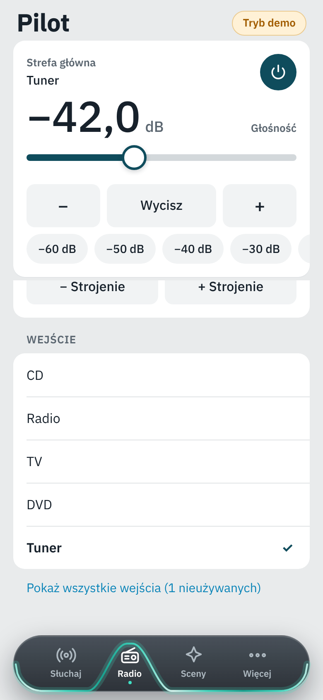
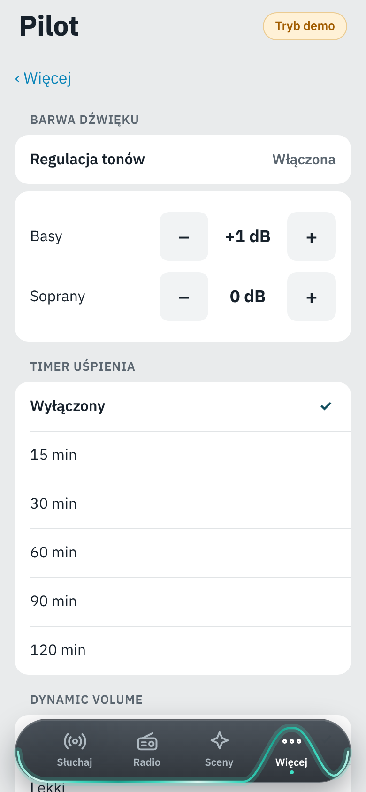
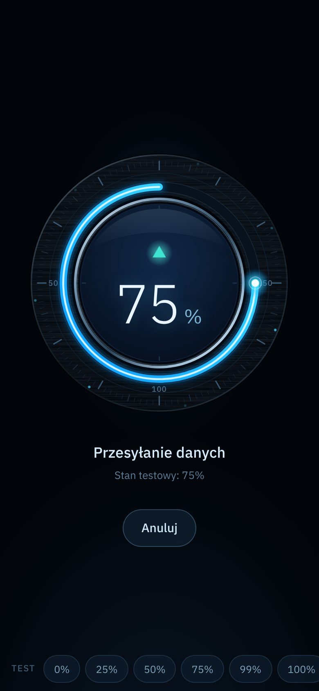

# Pilot Marantz 🎛️

**PL:** Własny, lekki pilot WWW do amplitunerów Marantz (testowany na **NR1602**) — działa w przeglądarce telefonu, bez aplikacji, bez chmury, bez zależności (sam Python 3).
**EN:** A small self-hosted web remote for Marantz receivers (tested on the **NR1602**). Runs in a phone browser, no app, no cloud, zero dependencies (plain Python 3 stdlib).

> **Wypróbuj bez amplitunera / Try without a receiver:** uruchom serwer i otwórz `/demo` — cała aplikacja działa na atrapie.

| Słuchaj | Radio | Tuner FM | Dźwięk | Aktualizacja |
|---|---|---|---|---|
|  |  |  |  |  |

## Funkcje / Features

- Głośność, wyciszenie, zasilanie, wybór wejścia, tryby dźwięku (surround) — strefa główna i **Strefa 2**
- **Radio internetowe**: lista ulubionych z amplitunera, jedno dotknięcie = start, karta „Teraz gra”
- **Tuner FM**: strojenie ±0,1 MHz, presety, wyświetlanie stacji
- **Dźwięk**: bas/wysokie (tone control), Sleep timer, Dynamic Volume, Dynamic EQ
- **Sceny**: zapisz stan (wejście, głośność, tryb) i przywołaj jednym przyciskiem
- Opcjonalnie: przy wyłączaniu strefy głównej najpierw przełącz na wskazane wejście (`PILOT_OFF_SOURCE`)
- Premium ekran aktualizacji w stylu Hi-Fi, ochrona przed utratą ustawień przy aktualizacji, historia wersji
- PWA (ikona na ekranie głównym), interfejs po **polsku**, brak zewnętrznych zasobów (fonty lokalnie)

## Szybki start / Quick start

Wymagania: Python 3.8+ i amplituner w tej samej sieci (zalecany stały adres IP / rezerwacja DHCP).

```bash
git clone https://github.com/<ty>/marantz-pilot.git && cd marantz-pilot
AMP_HOST=192.168.1.50 python3 server.py
# w LAN: PILOT_BIND=0.0.0.0 AMP_HOST=... python3 server.py
# otwórz http://localhost:8135/   (demo bez amplitunera: http://localhost:8135/demo)
```

Na amplitunerze włącz **Network Standby** (Setup → Network → Network Standby), żeby dało się go włączać z sieci.

### Zmienne środowiskowe

| Zmienna | Domyślnie | Opis |
|---|---|---|
| `AMP_HOST` | — (wymagana) | adres IP amplitunera |
| `PILOT_PORT` | `8135` | port serwera |
| `PILOT_BIND` | `127.0.0.1` | adres nasłuchu (`0.0.0.0` = dostęp z całej sieci LAN, bez nginx) |
| `PILOT_DATA` | `./data` | katalog na dane (sceny) |
| `PILOT_OFF_SOURCE` | puste | kod wejścia (np. `DVD`), na które przełączyć przed wyłączeniem strefy głównej |
| `PILOT_STATIONS` | puste | lista stacji oddzielonych przecinkami (opcjonalna kolejność/filtr) |

### Jako usługa / za nginx

- `sudo AMP_HOST=192.168.1.50 ./deploy/install.sh` — usługa systemd (`deploy/marantz-pilot.service`)
- `deploy/nginx.conf` — fragment dla ścieżki `/marantz/`
- Aby wystawić w LAN bez nginx: `PILOT_BIND=0.0.0.0` (domyślnie tylko `127.0.0.1`).

## ⚠️ Bezpieczeństwo

Aplikacja **nie ma uwierzytelniania**. Każdy, kto ją otworzy, steruje Twoim amplitunerem. Używaj wyłącznie w zaufanej sieci domowej (lub za VPN/reverse proxy z logowaniem). **Nie wystawiaj do internetu.**

## Zgodność / Compatibility

Testowane tylko na **Marantz NR1602**. Modele z rodziny Denon/Marantz z interfejsem `goform` i telnetem (port 23) powinny działać częściowo; funkcje (np. tuner, tone control) zależą od modelu. Zgłoszenia i PR-y z innych modeli mile widziane. Szczegóły protokołu: [docs/AMP-NOTES.md](docs/AMP-NOTES.md).

## Struktura

```
server.py            serwer (stdlib, proxy do amplitunera)
index.html           cała aplikacja (vanilla JS)
static/              ikony, fonty, menu, ekran aktualizacji, tryb demo
deploy/              systemd, nginx, install.sh
docs/                notatki o protokole, zrzuty ekranu
```

## English summary

Set `AMP_HOST` to your receiver's IP and run `python3 server.py`. The UI (Polish) offers volume/power/input/surround for main zone and Zone 2, internet radio favorites with "now playing", FM tuner, tone/sleep/dynamic EQ, scenes and a Hi-Fi style update screen. There is **no authentication**: keep it on your LAN. Open `/demo` for a mock mode that needs no hardware. Translations of the UI are welcome (strings live in `index.html`).

## Licencje / License

Kod: [MIT](LICENSE). Czcionka IBM Plex Sans: SIL OFL 1.1 ([static/fonts/OFL.txt](static/fonts/OFL.txt)).
Marantz® i Denon® są znakami towarowymi ich właścicieli; projekt jest niezależny i nie jest z nimi związany. Używasz na własną odpowiedzialność.
